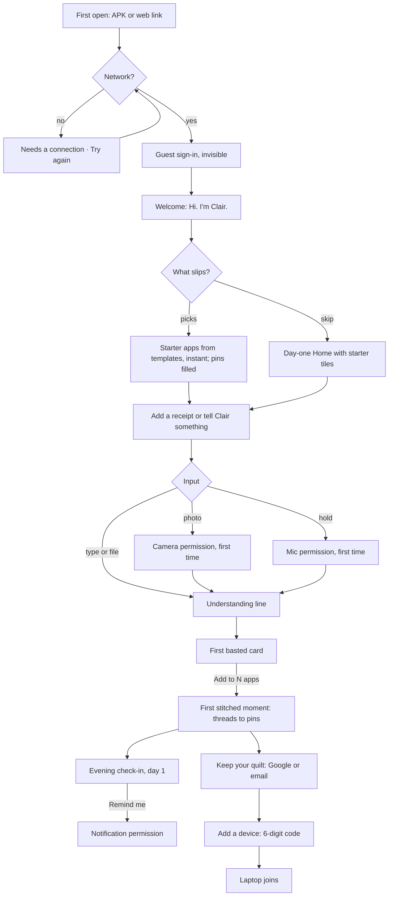

# Onboarding journey: Sam, first open to second device

Nov 19, 2026 · Quilt founding team (drafted with Claude) · Requirements: FR-O1 to FR-O5 and FR-X1 in `spec/prd.md` · Story: US-9 in `spec/prd-stories.md` · Server side: `spec/backend.md` §8 (auth and accounts) · Clair side: `spec/clair-agent.md`

## Executive summary

This map covers Sam's first day with Quilt, from opening the Android app or the web link to the same quilt showing on a laptop. Sam arrives with no account and no data and won't sit through setup, so Quilt signs Sam in as a guest without asking, makes starter apps from templates in one tap, and puts the first capture one tap away. Whether Sam stays depends on the first stitched moment, when Sam confirms a first basted card and watches threads land on several pins. Everything before it should be as short as possible. Quilt asks for everything after it (check-in, "Keep your quilt", second device) only once Sam has seen value. The biggest risks are a guest losing their quilt before keeping it, and a first capture that fails or has nothing to capture.

Every emotion and severity below is a hypothesis, since there are no interviews or survey data yet. Metrics have no baselines, and targets marked *proposed* are founder proposals.

## Persona

Sam, the forgetting-tax student (`docs/research/persona-sam-student.md`, PU-001, Proto). A U of U undergrad who installs and drops apps in minutes, logs in 10 to 60 second gaps, won't hand over a bank login, and goes back to the Notes app if capture fails twice. Sam's adoption filter: "Is it free to start? Does it want my bank login? Does it work on my phone right now? Will I have to set it up?" Three persona rules shape this journey: never require setup before the first useful screen, offer ready apps instead of a blank canvas, and avoid jargon (use "workspace" and "account" only where unavoidable).

## Scope

- **Journey type:** linear, day 0 to day 1, with one return visit.
- **Included:** first open (Android APK or web link) → guest sign-in → Welcome → "What slips?" → starter apps → first prompt → first basted card → first stitched moment → day-1 evening check-in → "Keep your quilt" → second device by join code. Also permissions, empty, error and no-network states, Clair's copy at each step, and metrics per stage.
- **Excluded:** acquisition (how Sam hears about Quilt), building a new app from a sentence (US-6), billing and credits top-up, sharing, account deletion, merging two quilts.

## Stages

| # | Stage | Sam's goal | Duration | Enters when | Leaves when |
|---|---|---|---|---|---|
| 1 | **Opens** | See what this is without signing up | Under 5 s | Taps the APK icon or the web link | Welcome is on screen (guest account made in the background) |
| 2 | **Picks** | Get apps that fit without building anything | 10 to 20 s | Welcome shows "What slips?" | Starter apps are on Home |
| 3 | **Captures** | Log one real thing | 30 s to a few min | Home shows "Add a receipt or tell Clair something" | A basted card is on screen |
| 4 | **Sees it stitch** | Check it's right and save it | 10 to 30 s | Basted card shown | Threads land on the pins; "just changed" tags show |
| 5 | **Comes back** | Catch what slipped today | Under 1 min, evening of day 1 | Opens Quilt in the evening, or (Beta) a reminder | Check-in reviewed; reminder choice made |
| 6 | **Keeps** | Not lose it; see it on the laptop | 1 to 2 min | First value seen (stage 4 done) | Account linked to Google or email; laptop joined by code |

## Step by step: what Sam sees and what Clair says

Copy rules (FR-C11, `.impeccable/surfaces/app.md`): plain verbs on buttons, no exclamation marks, no pronoun for Clair except Clair's own first-person lines, one spool per screen.

### 1. Opens

| Step | What happens | Screen and copy |
|---|---|---|
| 1.1 First open | APK launch or web link. A splash with the spool, no login screen. | (none) |
| 1.2 Guest sign-in | Supabase anonymous sign-in runs in the background; the server creates an empty workspace in Sam's time zone. Sam sees nothing of this. No permission prompts at launch. | (invisible) |
| 1.3 Welcome | Spool hello. | Clair: **"Hi. I'm Clair. I keep track of the stuff that slips."** Small links at the bottom: **"I have a quilt · Sign in"** (email and password; Live for the demo account) · "Enter a code from your phone" |

The Welcome board ("Day one") on the master canvas needs three copy updates before it matches this map. It greets "Hi, Sam", but a guest has no name yet. It says "Snap" and "Snap/Ask", which the Clair button replaced. And it shows 4 starter tiles where this map puts the "What slips?" chips first.

### 2. Picks

| Step | What happens | Screen and copy |
|---|---|---|
| 2.1 What slips? | One question, six multi-select chips. Nothing preselected. | **"What slips for you?"** Chips: Money · Groceries · Classes · Workouts · Subscriptions · To-dos. Note under the chips: "Pick any. You can add more later." Buttons: **Make my apps** · Skip |
| 2.2 Starter apps | Each chip maps to a template; the server copies the template specs into the workspace in one request. **No Claude call, no wait.** Money and Subscriptions both map to one Budget & subscriptions app. Calendar is always added, since every starter has dates. | Spool working for under a second, then Home |
| 2.3 Pins | The chosen apps fill the pinned bar (up to 4, Calendar last), so the first thread has somewhere to land. Clair re-seeds pins after the first week (FR-P2). | (bar fills) |
| 2.4 Skip | No apps are made. Home shows the day-one layout from the Welcome board: 4 starter tiles plus the first prompt. A first capture can still make an app (Clair proposes one, `propose_app`). | Bar note: "Your most-used apps get pinned here" |

| Chip | Template |
|---|---|
| Money, Subscriptions | Budget & subscriptions (one app; Subscriptions adds the renewals tab) |
| Groceries | Groceries (Weekly shop list, trips) |
| Classes | Classes |
| Workouts | Workout |
| To-dos | To-dos |
| (always) | Calendar |

Starter apps are empty. Budget's face reads "Set a monthly amount" until Sam types one in the patch. Setting it is optional and never blocks a capture.

### 3. Captures

| Step | What happens | Screen and copy |
|---|---|---|
| 3.1 First prompt | Home, day one. The status line has no data to report, so it carries the prompt. Needs your OK and Next up are hidden (empty). | Status line: **"Nothing logged yet. Add a receipt or tell Clair something."** A one-time chalk hint points at the Clair button. |
| 3.2 Clair sheet | Tap the Clair button. | Clair: "Tell Clair anything." Chips: Photo · File. Text field (not focused). Hold the button to talk. |
| 3.3 First photo | Tap Photo. **Camera permission asked now**, not before. | OS camera prompt. Denied: see Errors. |
| 3.3b First hold-to-talk | Hold the Clair button 450 ms. **Mic permission asked now.** On-device speech recognition shows a live transcript; release sends. The speech recognition plugin is a **spike (T1)**; if it fails, a hidden scripted-transcript toggle is the fallback (`spec/clair-agent.md` §4). | Sheet: "Listening" with the stitch waveform and the live transcript |
| 3.4 Clair works | One agent loop for any input (`spec/clair-agent.md`). | Status line: "Reading your receipt…"; past 6 s: "Still reading the items…" |
| 3.5 Understanding line | Clair says what it thinks the input is before proposing. | "Corner Market receipt · 8 items · $35.83" (or "I see your fridge: 14 items") |
| 3.6 First basted card | One proposal card with dotted chalk edge. The count follows the apps Sam has. | "Adding updates 2 apps" (Groceries, Calendar; 3 if Budget exists) · **Add to 2 apps** · Review items |
| 3.7 If Clair speaks | Only when Sam talked first: one line of 15 words or fewer through the phone's text-to-speech. Card stays on screen. Mute toggle in the sheet header. | Spoken: "Eight items from Corner Market. Add to two apps?" |

If the first input fits no app ("log my run" with no Workout app), Clair offers to build one: "No app tracks runs yet. Make a Runs app?" Clair never files the input to an unrelated app.

### 4. Sees it stitch (the moment of truth)

| Step | What happens | Screen and copy |
|---|---|---|
| 4.1 Confirm | Tap **Add to 2 apps**. One change set is written. | Button disabled during the pull |
| 4.2 Threads | Threads run from the card's dye dots to each target pin; each pin gets the mustard "just changed" tag; numbers roll. | Live region: "Added to Groceries and Calendar." Undo toast, at least 8 s: "Added · Undo" |
| 4.3 First-time hint | Shown once, after the threads land. | "Threads show where it went. Tap a pin to see it." |
| 4.4 Open a pin | Tap Groceries: the new rows, with "just changed". | Board: **Empty** ("New app ready") covers an app opened before its first row: "Groceries is ready. Add your first one. The fastest way is usually a photo." Its "Snap a bill or receipt" button needs renaming to "Add a photo". |

### 5. Comes back (day 1 evening)

| Step | What happens | Screen and copy |
|---|---|---|
| 5.1 Check-in card | When Sam opens Quilt after 6 pm on day 1, Needs your OK holds one check-in card built only from data already in Quilt. | "3 things from today" · Review. Items like "Corner Market · $35.83 added", "Return library books · due tomorrow" |
| 5.2 Reminder offer | After Sam reviews the first check-in, one line offers a reminder. | "Want a reminder at 8 pm for these?" · **Remind me** · No thanks |
| 5.3 Notifications | **Notification permission asked only after "Remind me".** Reminders are scheduled on the device (local notifications); no push server. | OS prompt. Denied: "Reminders are off. Turn them on in Settings any time." |

### 6. Keeps

| Step | What happens | Screen and copy |
|---|---|---|
| 6.1 Keep your quilt | The next time Home opens after the first confirm (never during the thread pull), one card in Needs your OK. | **"Keep your quilt."** "Right now your apps live only on this phone. Add Google or an email so you can get them back on any device." · **Continue with Google** · Use email · Not now |
| 6.2 Link | Links Google (`linkIdentity`) or an email (`updateUser`) to the same guest account; no data moves. An email has to be confirmed from the inbox first. | Google: "Kept. Your quilt is saved to sam@…" · Email, until confirmed: **"Check your email to finish keeping your quilt."** (then "Kept. Your quilt is saved to sam@…") |
| 6.3 Not now | Card goes away; asked once more after 3 more confirms, then only from Settings. | (none) |
| 6.4 Add a device | Phone: Settings → Add a device shows a 6-digit join code. Off until the quilt is kept and the email confirmed: a guest is sent to 6.1 first, an unconfirmed email sees "Check your email to finish keeping your quilt." | "Open Quilt on your laptop and enter **482 913**. The code works once and expires in 5 minutes." |
| 6.5 Laptop joins | The website's Welcome has "Enter a code from your phone". Six boxes. | Success: "Joined. Same quilt as your phone." The laptop's own empty guest workspace (made on its first open) is orphaned on the server and purged later (`spec/backend.md` §8, §12). |

## Permissions, just in time

| Permission | Asked when | Never asked | If denied |
|---|---|---|---|
| Camera | First tap on Photo | At launch, during onboarding | "Camera is off for Quilt. Pick a photo instead, or turn it on in Settings." Buttons: Pick a photo · Open settings. Nothing is sent. |
| Microphone | First hold on the Clair button | At launch; on a tap | "Microphone is off. Type instead, or turn it on in Settings." Hold then behaves like a tap. |
| Notifications | After the first check-in is reviewed and Sam taps "Remind me" | Before Sam has seen a check-in | Reminders stay off; check-ins still show in Needs your OK. |
| Photos / files | Handled by the OS picker; no Quilt prompt | | |

## Empty, error and no-network states

| State | What Sam sees | Copy |
|---|---|---|
| No network on first open | Spool sleepy, one button. Guest sign-in waits. | "Quilt needs a connection to set up. Try again." |
| Guest sign-in or seeding fails | Same screen, frayed edge. | "Couldn't set up. Try again." |
| Starter apps fail to save | Picks stay selected; frayed edge on the button area. | "Couldn't make your apps. Try again." |
| Skipped every chip | Day-one Home (Welcome board layout), 4 starter tiles, empty bar with note. | "Your most-used apps get pinned here." |
| App with no rows | Empty board. | "<App> is ready. Add your first one." |
| Home with no data | Status line carries the prompt; empty sections hidden. | "Nothing logged yet. Add a receipt or tell Clair something." |
| Photo unreadable | No proposal. | "Can't read this one. Try a closer photo?" |
| Photo with nothing to add | Understanding line, no card. | "I see a sunset. Nothing to add." |
| Clair slow | Status line only, no spinner. Past 6 s it says what it's doing; past 12 s, Try again. | "Still reading the items…" · "Taking too long. Try again." |
| No speech heard | Sheet stays open. | "Didn't catch that. Hold and try again." |
| Confirm fails | Frayed edge, rows stay basted. | "Couldn't add. Try again." |
| Offline after setup | Home and apps paint from the device cache. Writes and Clair are off until the connection is back (no offline write queue). | Bar note: "Offline. Showing what you had." Clair sheet: "Clair needs a connection." |
| Join code wrong or expired | Boxes clear. | "That code didn't work. Get a new one on your phone." |
| Email already has a quilt | Nothing is merged. | "That email already has a quilt. Use another, or sign in to that one (this phone's guest quilt stays here)." |
| Google link cancelled | Card stays. | (none) |
| What Clair remembers, empty | Settings list. | "Nothing yet. Notes like 'stopped buying orange juice' show up here." |

## Emotional curve (all Hypothesis, confidence Low)

| Stage | Dominant emotion | Confidence | Source |
|---|---|---|---|
| Opens | Wary curiosity ("will it want my email, my bank?") | Low | Hypothesis; persona adoption filter |
| Picks | Relief (nothing to build) | Low | Hypothesis; persona "blank-canvas paralysis" |
| Captures | Impatience; doubt that the read will be right | Low | Hypothesis; persona "two strikes" |
| Sees it stitch | Surprise, then trust ("it went everywhere, and asked first") | Low | Hypothesis; pitch doc magic moment |
| Comes back | Mild guilt turning to calm (caught what slipped) | Low | Hypothesis |
| Keeps | Mild reluctance to give an email, eased by having something worth keeping | Low | Hypothesis |

## Pain points and moments of truth

| Stage | Pain or moment of truth | Severity (1-5) | Evidence | Implication |
|---|---|---|---|---|
| Opens | **MoT: no sign-up wall.** A login screen before value fails Sam's adoption filter | 5 | Persona §6 (assumed) | Guest first (FR-O1) |
| Picks | Too many questions before anything useful | 4 | Persona "never require setup" (assumed) | One question, one tap, instant templates (FR-O2, FR-O3) |
| Captures | No receipt at hand on day one | 4 | PRD assumption: students often pay by card | Typing, talking, any photo and files all work through one loop |
| Captures | First read is wrong or slow | 5 | Persona "two strikes" (assumed) | Review items before OK; status line; Try again |
| Sees it stitch | **MoT: first stitched moment.** Sam sees one capture land in several apps | 5 | Pitch doc thesis; untested | Pins must exist on day one (2.3), or the threads have nowhere to land |
| Comes back | **MoT: day-1 return.** The check-in shows only what Quilt already knows | 4 | PRD risk row (wallet data) | Check-in built from Quilt data only (FR-C9) |
| Keeps | Guest loses the phone or uninstalls before keeping | 4 | Supabase anonymous accounts can't be recovered | Ask right after first value (FR-O5); required before a second device |

## Opportunities

| Stage | Opportunity | Product change | Effort |
|---|---|---|---|
| Picks | Make picks feel like Sam's own apps | Show the patch dye and name appear on each chip as it is picked | Small |
| Captures | Show the stitch to someone with no receipt | "Try with a sample receipt" chip on day one, marked "sample", removed by Undo or after the first real capture | Medium |
| Sees it stitch | Make the first stitch readable | One-time hint after threads land (4.3) | Small |
| Comes back | Bring Sam back on day 1 without push infrastructure | Local notification at a time Sam picks | Small |
| Keeps | Raise keep rate | Ask after value, name what's at risk ("live only on this phone"); one retry, then Settings only | Small |

## Metrics per stage (Beta)

These metrics are Beta and not built for DevDay. The events will go to a `product_events` table later, and nothing below is logged on Nov 20. There are no baselines. Rates get targets after 2 weeks of beta data, and time targets are *proposed*.

| Stage | Metric | Event(s) | Target |
|---|---|---|---|
| Opens | Time from first open to Welcome on screen | `app_opened` → `welcome_shown` | Under 3 s p75 *(proposed)* |
| Opens | Guest sign-in failure rate | `guest_signin_failed` | Track |
| Picks | Share who pick at least 1 chip; share who skip | `slips_picked {chips[]}`, `slips_skipped` | Track |
| Picks | Time from "Make my apps" to Home | `starters_created` | Under 1 s p75 *(proposed)* |
| Captures | Time to first Clair input; input kind mix (photo, text, voice, file) | `clair_turn_started {kind, first:true}` | Track |
| Captures | Time to first basted card; share of first inputs that yield one | `proposal_shown {first:true}` | Track |
| Captures | Camera and mic grant rates | `permission_result {kind, granted}` | Track |
| Sees it stitch | **Time to first stitched moment** (first open → first confirmed change set) | `change_set_confirmed {first:true}` | Median under 3 min *(proposed)* |
| Sees it stitch | Share of new guests reaching it on day 0 | same | Track; this is the activation measure |
| Sees it stitch | First-confirm undo rate | `change_set_undone {first:true}` | Track |
| Comes back | Day-1 return; check-in reviewed; reminder opt-in; notification grant rate | `checkin_reviewed`, `reminder_set`, `permission_result {kind:notifications}` | Track |
| Keeps | Keep rate by day 7; Google vs email split | `quilt_kept {method}` | Track |
| Keeps | Second device joined by day 7; join code failures | `device_joined`, `join_code_failed {reason}` | Track |

## DevDay (Nov 20) versus later

On stage the phone runs the seeded demo account (it has a confirmed email and a password; the phone signs in with "I have a quilt · Sign in"), and the laptop joins it with a join code, or signs in the same way if the code fails (FR-X1). The guest onboarding path is Live+ and stays out of the demo. It is shown in Q&A only if it runs on a fresh install.

| Step | Nov 20 | Later |
|---|---|---|
| Join code for the laptop, demo account | **Live** | |
| Guest sign-in on first open, Welcome, "What slips?", starter templates | Live+ | Beta if not built |
| First prompt, camera permission on first photo | Live (inside the demo) | |
| Mic permission on first hold, voice in and out | Live+ (speech recognition is a spike at T1; scripted transcript toggle as fallback) | |
| First basted card, first stitched moment | **Live** (the demo path) | |
| One-time hints (Clair button, threads) | | Beta |
| Day-1 evening check-in | Proto | Beta |
| Reminder and notification permission | | Beta |
| Keep your quilt (Google, email) | | Beta |
| Sign in on a returning device ("I have a quilt · Sign in") | **Live** (email and password only; it signs the phone in to the demo account) | Google sign-in |
| Sample receipt on day one | | Beta |

## Visual

## Research gaps

- Every emotion and severity above is a hypothesis. The planned U of U survey should ask: would you give an email before trying an app; do you have paper receipts on a normal day; which of the six "slips" apply.
- We don't know how many guests never keep their quilt, or how long to keep unused guest workspaces on the server. For now the server keeps them (`spec/backend.md` §12), and the retention rule is still open.
- We don't know whether the first stitched moment lands as well for a user with only 2 apps (Groceries and Calendar) as it does with 3 on stage.
- There is no data on day-1 return or reminder opt-in, so the 8 pm default is a guess.

## Design boards

Existing, on the master canvas https://claude.ai/artifact/TuTh7izChf3Dk74gvBvi7P:
- **Welcome** ("Day one"): stage 1 and the skip path. Copy updates listed in stage 1.
- **Empty** ("New app ready"): an app before its first row. Rename "Snap a bill or receipt" to "Add a photo".

Offered, not built: "What slips?" chips, day-one Home with the first prompt, Keep your quilt card, Add a device (phone code and laptop entry), permission-denied lines in the Clair sheet.
