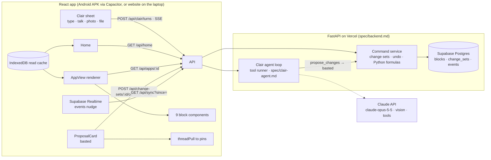

# Quilt UI: tech plan

Nov 19, 2026 · for the DevDay build (Nov 20) · reads with `PRODUCT.md`, `.impeccable/surfaces/app.md`, the pitch doc, **`spec/backend.md`** (server, data, sync, auth, edge cases) and **`spec/clair-agent.md`** (Clair's agent loop) · terms in `GLOSSARY.md`

Quilt's UI is one renderer that draws any app from a checked JSON spec, plus a small set of chrome components (Home, bar, Clair sheet, proposal card) ported from the prototypes. Clair never writes UI code. **Revised Nov 19 evening:** the client is one React app built with Vite, wrapped with Capacitor for Android and served as a website for the laptop; the server is FastAPI on Vercel over Supabase, and every Clair input goes through one agent loop. This doc now covers the client: stack, contracts as the client sees them, the confirm animation, files, build order. The server side lives in `backend.md` and `clair-agent.md`.

Decisions with trade-offs are recorded as ADRs: [ADR-001 spec-driven renderer](adr/001-spec-driven-renderer.md), [ADR-002 mock API on route handlers](adr/002-mock-api-route-handlers.md) (superseded), [ADR-003 basted proposals](adr/003-basted-proposals.md), [ADR-004 Python backend on Vercel](adr/004-python-backend-on-vercel.md), [ADR-005 React + Capacitor](adr/005-react-capacitor-client.md), [ADR-006 Supabase blocks table](adr/006-supabase-blocks-table.md), [ADR-007 Clair agent loop](adr/007-clair-agent-loop.md), [ADR-008 online writes, read cache](adr/008-online-writes-read-cache.md).

## 1. Stack

| Layer | Choice | Why |
| --- | --- | --- |
| Client framework | React + TypeScript, built with Vite; React Router | One DOM app for Android and the web; the prototypes' CSS and motion port as-is (ADR-005) |
| Native shell | Capacitor, Android first (debug APK for DevDay); plugins: Camera, speech recognition, text-to-speech, App | Installed app feel, camera and on-device speech without a native rewrite; iOS later |
| Styling and tokens | Plain CSS: `tokens.css` (CSS variables) + one stylesheet per component, ported from the prototypes | The prototype CSS already encodes section A (fixspec); copying it is faster and safer than re-expressing it in Tailwind |
| Motion | CSS transitions + Web Animations API + the 10-line critically damped `spring()` from the prototypes | Everything in the motion system already runs on these; no library |
| Client state | One module store (`src/lib/store.ts`) read through `useSyncExternalStore`; IndexedDB read cache per workspace; Supabase Realtime subscription on `events` triggers `GET /sync?since=` | Paint from cache at once, then catch up; server holds the truth (ADR-008) |
| Types | Generated: FastAPI's OpenAPI → `openapi-typescript` → `src/api/types.ts` | Pydantic on the server is the single source; no hand-copied types (ADR-004) |
| Auth | `@supabase/supabase-js`: anonymous sign-in on first open; join code for a second device | Guest first (`backend.md` §8) |
| Server | FastAPI (Python) on Vercel; Supabase Postgres, Realtime, Storage | `backend.md` (ADR-004, ADR-006) |
| AI | Anthropic Python SDK tool runner on the server, model `claude-opus-5-5`; the client only streams SSE events from `POST /clair/turns` | `clair-agent.md` (ADR-007) |
| Voice | Capacitor speech recognition (Android) / Web Speech (laptop) in; Capacitor text-to-speech / `speechSynthesis` out, only when Sam talked first | No second AI vendor; Claude stays the only brain |
| Demo clock | `DEMO_NOW` on the server (default Fri 20 Nov 2026, 5:45 pm: after the 5:41 pm receipt, before Pull day at 6 pm), workspace time zone America/Denver; the client never computes "today" itself | "Today", "this month" and Next up read the same at rehearsal and at the pitch |

Not used: Next.js, Tailwind, any component library, any animation library, Redux/Zustand/React Query, client-side formula evaluation (all formulas run in Python on the server).

## 2. Architecture



**Build path.** A sentence goes to Clair (`POST /api/clair/turns`). Clair calls `propose_app` with an `AppSpec` (validated server-side; on failure one retry with the errors fed back, then a friendly frayed-edge error). The Build flow previews the spec through the same `AppView` the finished app uses, with example records. "Add to my apps" stores it.

**Render path.** `AppView` takes `{spec, data, faces}` and maps each block's `kind` to one of 9 components. Blocks never fetch; they read records from `data`. Faces and every computed value come from the server's Python formula engine; the client formats but never calculates. A block cannot do anything the spec cannot express, which is the point (ADR-001).

**Capture path.** Text, voice transcript, photo or file goes to `POST /api/clair/turns`, which streams SSE events: `status`, `understood`, `question` (a menu card), `note`, `proposal` (a basted card), `text_delta`, `done`. Nothing is written until confirm (section 4). Full contract: `clair-agent.md` §2.

**Home path.** Home has no per-app widgets. Every app emits the same signals, computed by one pure function from its spec and rows; Home is composed from those signals:

| Signal | Comes from | Home section |
| --- | --- | --- |
| `face` | `spec.face` evaluated ("$412 left", "12 items") | Patch number in Your apps; status line uses the face marked `status: true` |
| `pending` | basted proposals whose ops touch the app | Needs your OK (one card + "N more") |
| `dated` | rows in any collection with a `dateField`; Home takes the next 3 within 72 h (app.md says 24 h; 72 h keeps "Spotify renews Sun" in the seed) | Next up thread, dot in the app's dye |
| `changed` | change log entries since the app was last opened | "Just changed" tag / mustard notch |
| `lastOpened` | open events | Order of Your apps; "not opened in N wk" |

`composeHome(signals[], proposals, insight?, now)` builds the status line (money face + first Next up item), queue, thread and patch list. Clair-noticed insights are seeded fixtures for DevDay.

## 3. Contracts

All types come from Pydantic models on the server and reach the client as generated TypeScript (`openapi-typescript`, ADR-004); shown here as TypeScript for reading. Storage of these shapes (page, collection and record blocks) is in `backend.md` §2. **Contract changes from `backend.md` to fold in when the schemas are written:** select options are `{id, label, hint?}` (hint is display only, e.g. "Sat 21 Nov"); new field types `relation`, `formula` and `repeat`; views gain `addAt` (`start` | `end`) and `switch`; the app slug is `key`; stitched records carry a reserved `_via` property; records have a fractional `position`.

```ts
// ---- AppSpec: what Clair writes and the renderer draws ----
type Dye = 'butter'|'sage'|'sea glass'|'apricot'|'chambray'|'lavender'|'pear'|'blush';
type CollectionRef = `${string}/${string}`;          // "groceries/items"

type Field = {
  key: string; label: string;
  type: 'text'|'number'|'money'|'date'|'datetime'|'bool'|'select';
  options?: string[]; required?: boolean;
};
type Collection = {                                    // data, not UI
  id: string; name: string; fields: Field[];
  titleField: string; dateField?: string; amountField?: string;
};

type Scalar = string | number | boolean;
type Filter = { field: string; op: 'eq'|'ne'|'lt'|'gt'|'within'; value: Scalar };  // field may be 'done'
type Query  = { agg: 'sum'|'count'|'avg'|'max'|'last'; from: CollectionRef | '*dated';
                field?: string; where?: Filter[]; window?: 'today'|'week'|'month'|'all' };
type Term   = number | Query;
type Value  = Term | { minus: [Term, Term] };          // "$1,200 − sum(spend this month)"; deliberately not recursive
type Format = 'money'|'count'|'number'|'duration'|'text';

type Stitch = {                                        // declared on the receiving app
  from: CollectionRef; to: CollectionRef;
  map: { to: string; from?: string; const?: Scalar }[];   // target field ← source field or constant
  where?: Filter[];
};

type AppSpec = {
  v: 1; id: string; name: string; icon: string; dye: Dye;
  print?: 'solid'|'gingham'|'stripe'|'dot';
  collections: Collection[];
  tabs: PageBlock[];                                   // an app has 1..n tabs; a tab is a page block
  face: { value: Value; format: Format; label: string; status?: boolean };
  stitches?: Stitch[];
};

// ---- the 9 blocks ----
type ViewBase = { id: string; source: CollectionRef | '*dated'; fields?: string[];
                  where?: Filter[]; sort?: { field: string; dir: 'asc'|'desc' };
                  group?: string; swipe?: { right?: 'complete'; left?: 'delete' };
                  switch?: string };   // a select field: one chip per option ("Weekly shop 4"), filters the view; "New list" appends an option
type PageBlock = { kind: 'page'; id: string; title: string; children: LeafBlock[] };  // pages don't nest
type Block = PageBlock | LeafBlock;
type LeafBlock =
  | { kind: 'text';     id: string; text: string }
  | { kind: 'metric';   id: string; label: string; value: Value; format: Format; compare?: Value }
  | { kind: 'progress'; id: string; label: string; value: Value; target: Value; format: Format }
  | ({ kind: 'list' | 'table' | 'calendar' } & ViewBase)   // Arrange "flip" = change kind only
  | { kind: 'form';     id: string; collection: CollectionRef; fields: string[]; submit: string }
  | { kind: 'chart';    id: string; type: 'bar'|'line'; from: CollectionRef;
                        x: string; y: Query; window: 'week'|'month' };

// ---- data ----
type Row = { id: string; ref: CollectionRef; values: Record<string, Scalar>;
             done?: boolean; proposalId?: string; via?: { app: string }; createdAt: string };  // ISO with offset

// ---- Home and sync ----
type Dated   = { at: string; title: string; sub: string; app: string; rowId: string };
type Patch   = { id: string; name: string; icon: string; dye: Dye; print?: string;
                 face: string; changed: boolean; lastOpened: string; pinned: boolean };
type Insight = { id: string; text: string; apps: string[]; proposal?: Proposal };
type Change  = { seq: number; at: string; app: string;
                 kind: 'insert'|'update'|'delete'|'proposal'; rowId?: string;
                 proposalId?: string; status?: Proposal['status'] };
```

**Schema rules for Claude's structured output** (closed objects only, no recursion, no open `Record`s): the types above are written to that rule, which is why `PageBlock.children` is `LeafBlock[]`, `Value` stops at one `minus`, and `Stitch.map` is a list. Record `values` stay a `Record` in the API, but Clair never emits them directly; its `propose_changes` tool sends fields as key/value pairs (`clair-agent.md` §10). Check at T1 that strict tool use accepts the AppSpec schema for `propose_app`; if it is refused, build stays on recorded runs (it is not the judged feature).

**Renderer interface** (the module's whole surface):

```ts
<AppView spec={AppSpec} data={Record<CollectionRef, Row[]>} tab={string} onAction={(a: RowAction) => void} />
type RowAction = { type: 'add'|'edit'|'complete'|'delete'; ref: CollectionRef; row: Partial<Row> };
```

Each block component gets `{ block, ctx }` where `ctx = { spec, rows(ref), value(v) → number, format(n, f) → string, act(RowAction) }`. Blocks are pure views over `ctx`. `GET /api/apps/:id` returns every collection the spec's blocks read, including other apps' collections and `*dated`, so the renderer never makes a second request.

Notes on the block count: the brief lists "page, text, metric, progress, collection, list/table/calendar view, form, chart" and says 9. This plan makes **collection data** (declared in `spec.collections`, no UI) and counts list, table and calendar as three blocks with one shared shape, which gives 9 drawable blocks and makes the Arrange flip a one-field change. Confirm or adjust before T2.

Money is stored in integer cents; `format('money')` rounds to whole dollars for faces and status ("$376") and shows cents on rows and receipts ("$35.83").

## 4. Basted → stitched: the proposal model

Everything Clair wants to write is a `Proposal`. User actions inside an app (a form, a swipe, an edit) write directly with an undo toast; only Clair's writes are basted (ADR-003).

```ts
type RowOp =
  | { op: 'insert'; ref: CollectionRef; values: Record<string, unknown> }
  | { op: 'update'; rowId: string; values: Record<string, unknown> }
  | { op: 'delete'; rowId: string };

type Proposal = {
  id: string;
  status: 'basted' | 'stitched' | 'undone' | 'dismissed';
  source: { kind: 'text'|'voice'|'photo'|'file'|'insight'|'checkin'; label: string; at: string };
  mode: 'live' | 'fixture';            // fixture shows a visible "sample" mark on the card
  title: string;                       // "Corner Market"  ·  "3 things from today"
  summary?: string;                    // "8 items. Adding updates 3 apps:"
  ops: RowOp[];                        // what Clair wrote (editable via Review items)
  // computed by the server on every read and again at confirm, never by Clair:
  lines: { apps: string[]; what: string; val: string; sub?: string }[];   // one per destination (fixspec D3)
  expanded: RowOp[];                   // ops + stitch fan-out, each tagged via: { app }
  targets: string[];                   // app ids whose visible data changes, in thread order
  deltas: { app: string; before: string; after: string }[];   // faces that change, e.g. Budget "$412" → "$376"
  actions: { primary: string; secondary?: string };            // "Add to 3 apps" / "Review items"
};

// Superseded Nov 19: Clair now calls the propose_changes tool (insert, update, delete; clair-agent.md §10).
// Kept for reading history only.
type ProposalDraft = {
  title: string; summary: string;
  inserts: { ref: CollectionRef; fields: { key: string; value: string }[] }[];
};
```

**One proposal per user intent.** "Spent $12 on lunch, gym tomorrow 6 pm" is one proposal whose ops span Budget, Calendar and Workout, shown as one card with a line per destination and one "Add to 3 apps". The check-in and the receipt work the same way.

**Server rules** now live in `backend.md` §5 (command service: validate, expand stitches, affected apps, dry run, apply, undo with preconditions, the transition table). Two changes from the earlier version of this section: Clair may propose updates and deletes on records it has read (receipt lines close open items by id), and closing open items does not count toward the "more than 5 updates or deletes" flag. Receipt specifics: `clair-agent.md` §12.

**Client flow on confirm** (`ProposalCard`, same for Home queue and Clair sheet):

1. Tap primary. Set `busy`, bump `runId`, disable both buttons, fire `POST /api/change-sets/:id/confirm` without awaiting it.
2. Remove `.basted` (stitch tightens, `T.state`).
3. `threadPull` from each `[data-thread-source=<app>]` dot in the card to the matching `[data-thread-target=<app>]` in the frame. On each landing (70% of the draw): mark the app changed, roll its face and the status money using `deltas[].after`. When the confirm response arrives, its `faces` are the final values; if one differs from the delta, roll once more to it.
4. On Home: card exits, siblings FLIP, next queued card enters. In the Clair sheet: the sheet closes after the last landing and Home shows the tags (fixspec D3). Toast "Added to Groceries, Budget and Calendar." with Undo.
5. If the confirm request fails: retract the threads toward the source, re-add `.basted`, roll numbers back, show the frayed-edge error on the card. Nothing was saved, so nothing to repair.

**Undo:** `POST /api/change-sets/:id/undo`, threads retract (`T.focalOut`), notches fade, numbers roll back, card returns basted.

**Thread pull component contract** (no app logic in it):

```ts
threadPull(opts: {
  frame: HTMLElement;                                  // the phone frame / app root; svg is appended here
  pairs: { from: Element; to: Element; top?: boolean }[];
  onLand: (i: number) => void;                         // called at 70% of each draw, 120 ms stagger
  alive: () => boolean;                                // false once runId changed (undo, double tap)
}): Promise<boolean>;                                  // resolves after the 400 ms hold + fade
retractThreads(opts: Omit<typeof opts, 'onLand'>): Promise<void>;
```

Any element that can receive a thread sets `data-thread-target="<appId>"`: the bar pins first, then a Home patch. A target with no visible element lands with no thread (tag and roll only). Other devices never pull threads; they receive the change through the poll and show the "just changed" tag. Under reduced motion `threadPull` skips drawing and calls every `onLand` at once.

The client store holds poll results while `busy` is set and applies them after the run, so a re-render never lands mid-animation (the prototypes' "never a full render mid-sequence" rule). It advances `since` to the seq in the confirm response and ignores changes it already applied, so the confirming device never sees its own echo. Proposal changes (`kind: 'proposal'`) remove a confirmed card from the other device's queue.

**Where the photo lands.** The source docs disagree (app.md hides the bar while reviewing a receipt; fixspec keeps it visible under the Clair sheet so threads land on the pins). This plan: after a photo, the basted card appears inside the Clair sheet with the bar visible; Review items opens as a nested sheet that also keeps the bar; confirm pulls threads to the pins, then the sheet closes. A receipt confirmed from Home's queue pulls to the same pins.

## 5. API (summary)

The API is FastAPI on Vercel; the full endpoint table, status codes and the old-to-new path map are in `backend.md` §10. What the client uses most: `GET /api/home`, `GET /api/apps/:id`, `POST /api/records` (+ `PATCH`, `move`, `complete`, `skip`, `DELETE`), `POST /api/change-sets/:id/confirm | undo | dismiss`, `POST /api/clair/turns` (SSE), `GET /api/sync?since=`, `POST /api/join-codes` and `/redeem`. Every write returns the new `seq` and the faces it changed, so the client rolls numbers without recomputing.

Fixtures survive only as Clair's recorded runs, replayed on "Use sample" and marked "sample" (`clair-agent.md` §15).

**Seed (`api/seed/`, SQL + Python; every row is in `backend.md` §2.2 and §2.3).** Sam, evening of Fri 20 Nov 2026. Apps: Notes, Budget, Groceries, Calendar, To-dos, Workout, Subscriptions, Classes. No filler patches: a face needs rows behind it (`spec/prd-data-provenance.md`).

| Item | Values |
| --- | --- |
| Budget | $1,200 for November; spending rows so the face reads **$412 left**; face has `status: true` |
| Groceries | `items` with status to buy / bought and a `list` select field (Weekly shop, Taco night, Costco run; the list view has `switch: 'list'`). Weekly shop, the default, has 12 to buy (all 8 receipt items among them, plus Coffee filters, Tortillas, Olive oil, Dish soap); Taco night and Costco run have 5 each. Canonical item lists, usuals history and the Budget `limit` are in `backend.md` §2.2. The face counts the default list only, so Home still reads 12 → 4; `trips`; stitch `groceries/trips → budget/spend` (category Groceries) |
| Calendar | one calendar block over `*dated` (every app's dated rows) |
| Next up | Pull day 6 pm (Workout), Take out recycling 8 pm (To-dos), Return library books 9 pm (To-dos) |
| Queue | DevDay: the Corner Market receipt only (`/home` returns `change_set` cards). Full product: plus the evening check-in (Pull day, Take out recycling, Return library books) and the Hulu renewal suggestion (renews Wed 2 Dec, $9.99 a month, $119.88 a year) |
| Build from a photo (demo beat 1) | Clair → Photo of the printed car maintenance card + "make this an app" → `propose_app` Car (services, log), 3 service rows, Oil change on Calendar Sat 5 Dec, Transport stitch on Budget → Make it → 9 apps. Fill: Campus Auto receipt $44.99 → Budget $412 → $367 (`clair-agent.md` §12.0). "Use sample" replays recorded runs of both |
| Whiteboard (fallback beat and its sample) | Notes → CS 3500 → New note → Clair photo of the CS 3500 design-patterns board: note "Design patterns" in CS 3500, HW 4 due Tue 24 Nov 11:59 pm into Classes, Calendar through `*dated`; "Add to 3 apps"; Notes 3 → 4 this week, Classes 2 → 3 (`clair-agent.md` §12.0a) |
| Receipt (the demo photo and its sample fallback) | Corner Market, 5:41 pm, **$35.83**, 8 items: Oat milk 3.49, Eggs dozen 4.29, Bananas 1.87, Chicken thighs 8.62, Rice 5 lb 6.99, Spinach 3.29, Greek yogurt 4.29, Coffee beans 2.99 (the Receipt board's lines). Draft: 8 bought items + 1 trip. Server closes the 8 matching items on the to-buy list, stitches the trip to Budget spend and finds Calendar via `*dated`: targets Budget, Groceries, Calendar; deltas Budget **$412 → $376**, Groceries 12 → 4 to buy, Groceries spend $142 → $177.83 of $200 |
| Receipt test set | 3 real receipt photos from team shopping (photographed at T3) plus the printed demo receipt, run through live parse before the event |
| Capture fixture | "Spent $12 on lunch, gym tomorrow 6 pm" → Budget · Eating out · $12; Calendar + Workout · Gym · Sat 21 Nov, 6 pm; "Add to 3 apps" |
| Ask fixture | "Can I afford $60 concert tickets?" → template (days counted from today to the 1 Dec reset, 11 days) giving, after the receipt, "Yes. $376 left until 1 Dec; after $60 you'd have $316, about $29 a day." Sources Budget, Calendar; no proposal (a question changes nothing) |
| Demo order (pinned) | receipt photo → Add to 3 apps → laptop updates → Undo and redo → ask → (stretch) capture by text |
| Build fixture | "Track my plants" → Plants app spec (list + calendar of waterings, face "2 to water") |
| Share fixture | "Syllabus · ECON 1010.pdf, 4 pages" → 6 due dates and 2 exams into Classes and Calendar, "Add to 2 apps" |

The fixture values above are the single source for the demo script and the slides.

## 6. Files

```
web/                       React + Vite + Capacitor (this doc)
  src/main.tsx  src/App.tsx       routes: Home, /a/:key (an app), /build, /settings, /join
  src/api/types.ts                generated from the API's OpenAPI (never edited by hand)
  src/api/client.ts               fetch helpers, SSE reader for /clair/turns
  src/lib/store.ts                module store + IndexedDB cache + Realtime → /sync catch-up
  src/lib/motion.ts               T, EASE, RM, spring, project, rubberband, tracker, threadPull, roll, flip
  src/lib/native.ts               Capacitor Camera, speech recognition, text-to-speech, with web fallbacks
  src/components/blocks/          Page Text Metric Progress List Table Calendar Form Chart + index.ts
  src/components/                 AppView ProposalCard ClairSheet MenuQuestion Sheet SwipeRow Bar Spool Roll Toast SearchPull
  src/styles/tokens.css  base.css
  android/                        Capacitor Android project (debug APK)
api/                       FastAPI on Vercel (spec/backend.md, spec/clair-agent.md)
  index.py  routes/  commands.py  formulas.py  sync.py  auth.py  clair/ (loop, tools, prompts)  seed/  evals/
```

**Demo files vs after the cut line.** Needed for the demo: blocks Page, Text, Metric, Progress, List, Calendar; `AppView`, `ProposalCard`, `ClairSheet` (start, understood, menu question, result, ask), `MenuQuestion`, `Sheet`, `Bar`, `Spool`, `Roll`, `Toast`; `src/lib/` and `src/api/`. After the cut: Table, Form, Chart, `SwipeRow`, `SearchPull`, the Build route, Settings, `GET /api/search`, `PATCH /api/apps/:id`. Filler apps on Home are patch stubs with a hardcoded face, not full specs.

## 7. Tokens and motion in code

**`styles/tokens.css`** holds every value from fixspec section A as CSS variables on `:root`: colours (muslin ground, ink, ink2 `#665847`, denim `#22396F`, mustard `#E3A72F`, the 8 dyes by name), type (three families, the 13 px floor, Bricolage tracking steps), radii 4/8/12/16/22, spacing on 4 px, motion durations and easings:

```css
:root{
  --ease: cubic-bezier(.16,1,.3,1); --ease-thread: cubic-bezier(.45,0,.15,1);
  --t-fb:120ms; --t-state:220ms; --t-layout:350ms; --t-focal:600ms;
  --t-state-out:140ms; --t-layout-out:220ms; --t-focal-out:360ms;
}
@media (prefers-reduced-motion: reduce){
  :root{ --t-state:120ms; --t-layout:120ms; }
  .sheet,.toast{ transform:none !important; }        /* opacity only, per fixspec A */
}
```

Under reduced motion there is no movement anywhere: sheets and toasts fade, `flip()` and `roll()` swap values without translating, springs jump to the end, threads are skipped, the spool shows its face only.

Dark theme is out for DevDay; because every colour is a variable, the indigo theme is one later `[data-theme=dark]` block. `base.css` carries the mobile baseline (tap highlight, `overscroll-behavior`, 16 px inputs, `touch-action`, safe-area insets, hover gated behind `(hover:hover) and (pointer:fine)`, `:active` press feedback, scroller mask).

**`src/lib/motion.ts`** ports the prototype functions with their signatures unchanged, so the prototype code is the reference implementation:

| Export | Source | Used by |
| --- | --- | --- |
| `T`, `EASE`, `EASE_THREAD` | fixspec A | every WAAPI call (CSS uses the variables) |
| `RM` (live, `matchMedia` change listener) | fixspec A | every function below short-circuits on it |
| `spring(from, to, v0, response, onUpdate, onDone)`, `project`, `rubberband`, `tracker` | `design/prototypes/quilt-flows.html` | `Sheet` (drag to dismiss, response .35), `SwipeRow` (.25 out / .3 back), `SearchPull` (.35), build layout pager (.3), Arrange drop (.3) |
| `threadPull`, `retractThreads` | `design/prototypes/quilt-flows.html` `threadPull()` | `ProposalCard` only |
| `roll(el, text, down)` | `design/prototypes/quilt-home.html` `roll()` | `Roll` component (faces, status money) |
| `flip(container, mutate)` | `design/prototypes/quilt-home.html` `syncQueue()` | Home queue, row delete collapse |

React rules: animations run on refs, never through React state per frame; gesture handlers write `style.transform` directly and hand off to `spring`; a pointerdown cancels the running spring and starts from the live transform. One spool per screen, sizes 30/44/96, one-shot hop or shake only when the expression is newly entered (`Spool` tracks the last face per screen).

## 8. Build order

The hour-by-hour plan for both people now lives in `backend.md` §13 (tonight T1–T3, the day D1–D7, the T1 spikes). The client's share, person B:

| When | B: client |
| --- | --- |
| T1 | Vite + React scaffold, `tokens.css`, `base.css`, `motion.ts` port, `Bar`, `Spool`; Capacitor Android project builds a debug APK on the demo phone |
| T2 | `AppView` + 6 blocks (page, text, metric, progress, list, calendar) rendering seed data from `GET /api/apps/:id`; IndexedDB cache |
| T3 | Home (status line, Needs your OK, Next up, Your apps); generated types wired; Realtime → `/sync` catch-up |
| D1–D2 | `ProposalCard` (basted, `threadPull`, `roll`, tags), confirm and undo against the API, toast, `busy` hold |
| D3 | Real phone + laptop: confirm on the phone, laptop updates; join code screens; Android fixes (gestures, safe area, keyboard) |
| D4 | `ClairSheet`: start, photo (Capacitor Camera, 1568 px JPEG), SSE states (`understood`, `question` menu card, `note`, `proposal`) |
| D5 | Talk: speech recognition in, text-to-speech out when Sam talked first; Review items |
| D6 | Onboarding (Welcome, "What slips?", starter apps); then SwipeRow, pull-down search, Build on Clair |
| D7 | Polish against the design book; rehearse three times on the APK and the laptop |

**Never cut** D3's two-device check and the live receipt through Clair; they are the pitch. Below the line, cut from the bottom of D6 up.

**What we fake for DevDay:** nothing on screen is invented (`spec/prd-data-provenance.md`). Clair noticed is off until FR-H6 defines how it's computed, and the evening check-in shows only when FR-D16 ships; Clair runs live for every input, with recorded runs behind "Use sample"; voice is live (on-device speech), with a hidden scripted-transcript toggle for the stage; Workout, To-dos, Subscriptions and Classes render from seed specs but are not in the scripted demo; Home shows the 8 seeded apps and no stubs; laptop split view is a stretch.

## 9. Risks

| Risk | Why it bites | Answer |
| --- | --- | --- |
| Cold start or slow function | Vercel Python functions start cold; an agent run can approach the duration limit | Warm both devices 5 minutes before; `maxDuration` and SSE streaming checked at T1; "Use sample" after 12 s (`backend.md` §10, §13) |
| APK on the demo phone | Install, signing or WebView quirks found on stage | Sideload the debug APK the night before; the website in Chrome on the same phone is the backup |
| Judging rule | Only the feature built on Nov 20 is judged; a recorded run passed off as live would be dishonest | Clair loop and receipt path built on the day; every recorded run visibly marked "sample"; no silent fallback |
| Model output corrupts data | Wrong refs, fields or types | Clair only proposes; the server validates every op against the spec and the records it read (`backend.md` §5); nothing saves before OK |
| Vision latency or a misread | Several seconds per photo; blurry receipts | Downscale on device, effort `low`, the understanding line early, Review items before OK, the receipt eval set, "Use sample" |
| Stale numbers | Confirming one proposal changes another's deltas | Deltas recomputed on every read and at confirm; confirm returns final faces; pinned demo order |
| Clock and timezone | "Today", "this month", Next up shift with server time and rehearsal hour | `DEMO_NOW` and the workspace time zone on the server; the client never computes dates |
| Cross-device races | Laptop confirms an already-confirmed card; undo races confirm; own changes echo back | Guarded transitions (`409`), per-workspace lock, `seq` dedupe on the client |
| Public demo URL | Anyone can spend API credit | Supabase auth on every call, per-user and global rate limits, credits (`clair-agent.md` §14) |
| Re-render mid-animation | A Realtime catch-up repaints the card while threads draw | Store holds catch-up results while `busy`; animations run on refs with stable keys |
| Touch bugs in the Android WebView | Gestures, `100dvh`, safe areas, keyboard resize | Port the prototypes' gesture code as-is; real-phone check at D3 |
| Money rounding | Floats drift ("$376.17" vs "$376") | Integer cents everywhere; one `format()` |
| Prompt injection through photo or file text | Data could carry instructions for Clair | Untrusted-data rule in the system prompt, propose-only writes, server validation, injection cases in the evals (`clair-agent.md` §13, §16) |
| "9 blocks" count | Docs list 8 names and say 9 | Section 3's reading; confirm before T2 |
| Venue Wi-Fi | Live calls and two-device sync need network | Phone hotspot, "Use sample", recorded backup video |
